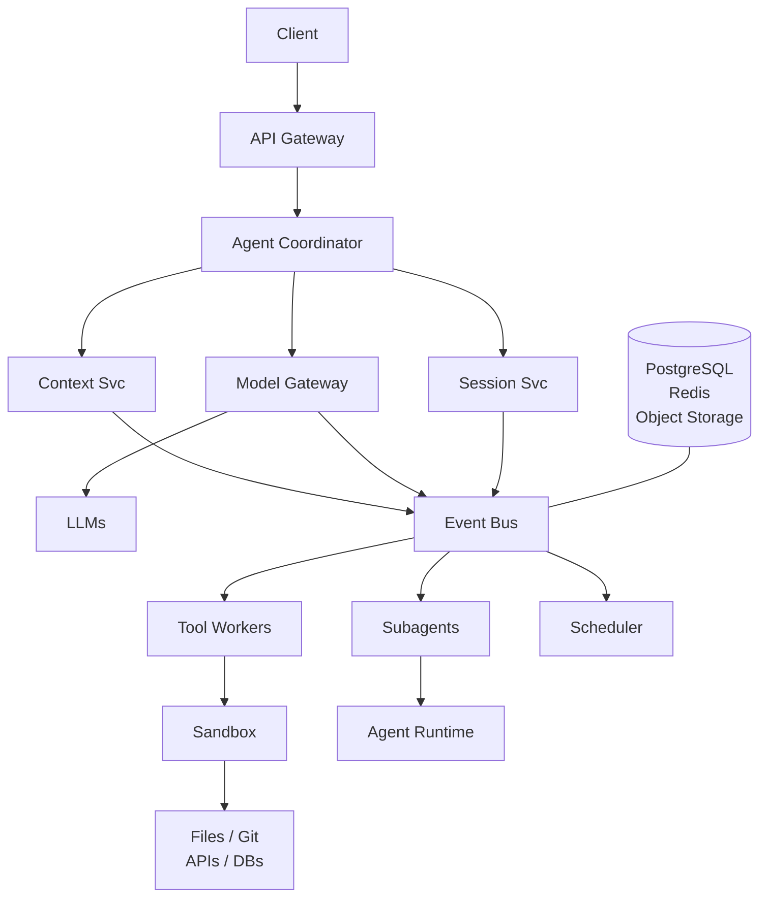
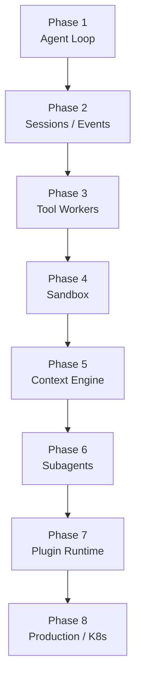

# DeepSeek-Style Agent Harness — Overview

- **Status:** Phase 1 done, Phase 2 next
- **Purpose:** Define the phased implementation of the agent harness.
- **Primary Goal:** Build a DeepSeek-style agent runtime from first principles, with a focus on backend and distributed-system design.

## 1. Project Objective

Build a production-oriented agent harness from first principles.

This project is **not**:

- a wrapper around an LLM
- a LangChain / LangGraph application

Instead, we build the underlying runtime responsible for turning an LLM into an agent capable of:

- reasoning over tasks
- using tools
- maintaining state
- executing actions
- persisting sessions
- recovering from failures
- operating inside a sandbox
- managing context
- delegating work to subagents
- running asynchronously
- enforcing permissions
- emitting observable events
- supporting replaceable components through plugins

### Core mental model

```text
Agent Capability ≈ Model + Harness + Environment + State
```

- The **model** provides reasoning.
- The **harness** provides the infrastructure required for that reasoning to become useful, controllable, persistent, and executable.

## 2. Target Architecture

This is the destination architecture, not the starting architecture.



In text form:

```text
                     CLIENT
                       │
                       ▼
                ┌─────────────┐
                │ API Gateway │
                └──────┬──────┘
                       │
                       ▼
              ┌──────────────────┐
              │ Agent Coordinator │
              └────────┬─────────┘
                       │
         ┌─────────────┼─────────────┐
         │             │             │
         ▼             ▼             ▼
    Context Svc    Model Gateway   Session Svc
         │             │             │
         │             ▼             │
         │           LLMs            │
         │                           │
         └──────────┬────────────────┘
                    │
                    ▼
               Event Bus
                    │
       ┌────────────┼────────────┐
       ▼            ▼            ▼
  Tool Workers   Subagents    Scheduler
       │            │
       ▼            ▼
   Sandbox       Agent Runtime
       │
       ▼
 ┌──────────────┐
 │ Files / Git  │
 │ APIs / DBs   │
 └──────────────┘

         ┌─────────────────────┐
         │ PostgreSQL          │
         │ Redis               │
         │ Object Storage      │
         └─────────────────────┘
```

The system is deliberately built incrementally toward this. See [Phase Dependency Map](#6-phase-dependency-map).

## 3. Build Philosophy

### 3.1 Build primitives ourselves

The core runtime should not initially depend on:

- LangChain
- LangGraph
- other agent orchestration frameworks

The purpose is to understand and implement the underlying primitives ourselves. Once the system works, frameworks can be studied and compared against our implementation.

### 3.2 Introduce distributed complexity gradually

Do not start with Kubernetes, Kafka, or multiple microservices / workers.

Intended progression:

```text
Single process
      ↓
Persistence
      ↓
Workers
      ↓
Sandbox
      ↓
Context
      ↓
Subagents
      ↓
Plugins
      ↓
Kubernetes
```

Each phase introduces one major architectural concept.

### 3.3 Keep interfaces stable

Use abstractions such as:

- `ModelProvider`
- `Tool`
- `ToolProvider`
- `SessionStore`
- `SandboxProvider`
- `EventBus`
- `ContextEngine`

Concrete implementations can change without changing the rest of the system. For example:

```text
ModelProvider
    │
    ├── OpenAI
    ├── DeepSeek
    ├── Anthropic
    └── Local model
```

## 4. Final Technology Stack

These are implementation choices, not architectural dependencies. For example, the event bus abstraction should not permanently depend on Redis.

| Area | Technology |
|------|------------|
| Language | Python |
| API | FastAPI |
| Database | PostgreSQL |
| ORM | SQLAlchemy |
| Async | asyncio |
| Cache / Queue | Redis |
| Event Bus | Redis Streams initially |
| Sandbox | Docker |
| Object Storage | S3 / MinIO |
| LLM | OpenAI / DeepSeek-compatible API |
| Observability | OpenTelemetry |
| Metrics | Prometheus |
| Deployment | Docker → Kubernetes |
| Frontend | Optional React |

## 5. Destination Project Structure

Important: this is the destination structure. Do not create all of it on day one.

```text
agent-harness/
│
├── apps/
│   ├── api/
│   │   └── main.py
│   │
│   └── worker/
│       └── main.py
│
├── core/
│   │
│   ├── agent/
│   │   ├── agent.py
│   │   ├── loop.py
│   │   └── state.py
│   │
│   ├── model/
│   │   ├── interface.py
│   │   ├── openai.py
│   │   └── deepseek.py
│   │
│   ├── tools/
│   │   ├── registry.py
│   │   ├── interface.py
│   │   ├── filesystem.py
│   │   ├── shell.py
│   │   └── web.py
│   │
│   ├── context/
│   │   ├── builder.py
│   │   ├── summarizer.py
│   │   └── tokenizer.py
│   │
│   ├── session/
│   │   ├── models.py
│   │   ├── repository.py
│   │   └── events.py
│   │
│   ├── sandbox/
│   │   ├── interface.py
│   │   └── docker.py
│   │
│   ├── orchestration/
│   │   ├── scheduler.py
│   │   └── subagents.py
│   │
│   ├── policy/
│   │   └── permissions.py
│   │
│   └── events/
│       ├── bus.py
│       └── handlers.py
│
├── plugins/
│   ├── models/
│   ├── tools/
│   ├── sandboxes/
│   └── storage/
│
├── infrastructure/
│   ├── postgres/
│   ├── redis/
│   └── docker/
│
├── tests/
│
├── docker-compose.yml
└── pyproject.toml
```

## 6. Phase Dependency Map

Each phase leaves a working system. We progressively transform:

```text
Simple Agent
     ↓
Persistent Agent
     ↓
Distributed Agent
     ↓
Sandboxed Agent
     ↓
Context-Aware Agent
     ↓
Multi-Agent Runtime
     ↓
Composable Harness
     ↓
Production Distributed System
```



| Phase | Doc | Transformation step |
|-------|-----|---------------------|
| 1 | [phase1.md](phase1.md) | Simple Agent |
| 2 | [phase2.md](phase2.md) | Persistent Agent |
| 3 | [phase3.md](phase3.md) | Distributed Agent |
| 4 | [phase4.md](phase4.md) | Sandboxed Agent |
| 5 | [phase5.md](phase5.md) | Context-Aware Agent |
| 6 | [phase6.md](phase6.md) | Multi-Agent Runtime |
| 7 | [phase7.md](phase7.md) | Composable Harness |
| 8 | [phase8.md](phase8.md) | Production Distributed System |

## 7. Definition of Done for the Overall Project

The project is complete when the harness can:

```text
Accept a task
     ↓
Create a session
     ↓
Reason using a replaceable model
     ↓
Select tools
     ↓
Check permissions
     ↓
Execute tools asynchronously
     ↓
Operate inside a sandbox
     ↓
Persist every important event
     ↓
Recover from failures
     ↓
Construct relevant context
     ↓
Delegate to subagents
     ↓
Collect results
     ↓
Continue / stop
     ↓
Produce final response
```

while the underlying components remain independently replaceable.

The final system should therefore be understood not as “an application that calls an LLM”, but as:

> A runtime that provides an environment in which an LLM can reliably operate.

## 8. Docs Index

- [Phase 1 — Agent Loop](phase1.md)
- [Phase 2 — Event-Sourced Sessions](phase2.md)
- [Phase 3 — Tool Runtime & Worker Architecture](phase3.md)
- [Phase 4 — Sandbox](phase4.md)
- [Phase 5 — Context Engine](phase5.md)
- [Phase 6 — Subagents](phase6.md)
- [Phase 7 — Plugin Runtime](phase7.md)
- [Phase 8 — Production Distributed Architecture](phase8.md)
