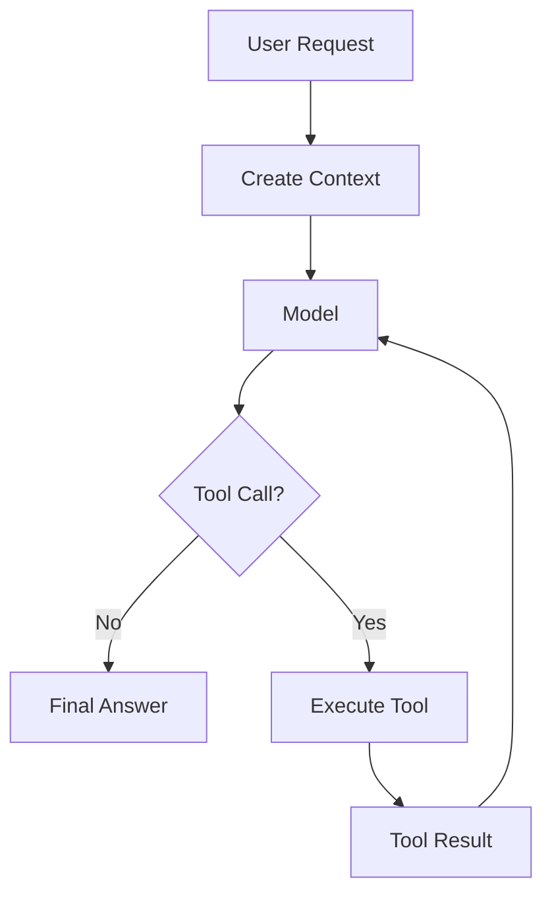

# Phase 1 — Agent Loop

- **Status:** Done (verified with scripted models; a live model run is still pending)
- **Goal:** Build the smallest useful agent runtime.
- **Prev:** [overview.md](overview.md) · **Next:** [phase2.md](phase2.md)

## 1. Objective

Build a single-process agent capable of:

```text
API
 ↓
Agent Loop
 ↓
LLM
 ↓
Tool
 ↓
LLM
 ↓
Response
```

No persistence, no workers, no sandbox yet. Just the loop done correctly.

## 2. Components

- **API:** accepts a user request and returns the final response.
- **Agent:** owns task state for the lifetime of one request.
- **Agent loop:** orchestrates Model → Tool Call? → Tool → Model → Answer.
- **ModelProvider:** stable interface behind OpenAI / DeepSeek-compatible calls.
- **Tool interface:** `name`, `description`, input schema, handler.
- **Tool registry:** lookup by name, schema validation, dispatch.
- **Basic context:** ordered message list built from user input + tool results.
- **Basic error handling:** model errors, tool errors, stopping conditions.

Early code surface (destination names, minimal subset):

```text
core/agent/loop.py        # run loop, stopping conditions
core/agent/agent.py       # per-request agent state
core/model/interface.py   # ModelProvider abstraction
core/tools/interface.py   # Tool abstraction
core/tools/registry.py    # registration + dispatch
```

Keep interfaces stable per [overview.md](overview.md):

- `ModelProvider`
- `Tool`
- `ToolProvider`

## 3. Core Flow



In text form:

```text
User Request
     │
     ▼
Create Context
     │
     ▼
Model
     │
     ▼
Tool Call?
   /     \
 No       Yes
 │         │
 ▼         ▼
Answer    Tool
           │
           ▼
        Result
           │
           └──────► Model
```

Loop rules:

1. Append user message to context.
2. Call model with tools + context.
3. If no tool calls, return final answer.
4. Otherwise validate each call against the registry, execute, append results, repeat.
5. Enforce `max_iterations`, timeout, and token limits to guarantee termination.

## 4. Example

User:

> Find all Python files in this project and tell me which contain FastAPI endpoints.

Expected trace:

```text
User request
     ↓
LLM
     ↓
filesystem.list
     ↓
result
     ↓
LLM
     ↓
filesystem.read
     ↓
result
     ↓
LLM
     ↓
Final answer
```

This exercises multi-step reasoning, repeated tool use, and result incorporation.

## 5. What We Learn

- LLM tool calling and structured model responses
- Agent loops and stopping conditions
- Tool schemas and validation
- Context construction
- Failure handling (unknown tool, bad args, tool exception, model error)

## 6. Completion Criteria

The agent can:

- [x] receive a request
- [x] call the model
- [x] interpret tool calls
- [x] execute registered tools
- [x] provide tool results back to the model
- [x] continue the loop
- [x] produce a final response

## 7. Exit Criteria / Unlocks

- Loop terminates reliably with or without tools.
- Adding a new tool requires only registry registration, no loop changes.
- Ready for Phase 2 persistence: loop steps map cleanly to events.
