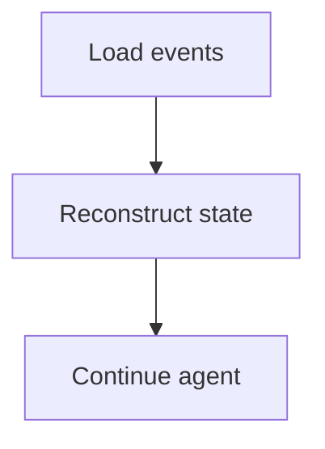

# Phase 2 — Event-Sourced Sessions

- **Status:** Planning
- **Goal:** Move from an ephemeral agent to a persistent runtime.
- **Prev:** [phase1.md](phase1.md) · **Next:** [phase3.md](phase3.md)

## 1. Objective

Replace “session = giant JSON object” with “session = ordered event log”:

```text
Session
   │
   ├── Event
   ├── Event
   ├── Event
   ├── Event
   └── Event
```

Storage starts with PostgreSQL.

## 2. Core Entities

```text
sessions
---------
id
user_id
status
created_at
updated_at

events
------
id
session_id
sequence_number
type
payload
created_at
```

Related tables introduced here: `sessions`, `events`, `tool_calls`, `agents`.

Critical constraint:

```text
(session_id, sequence_number) UNIQUE
```

This enforces ordering, enables idempotent appends, and makes replay deterministic.

Early code surface:

```text
core/session/models.py      # sessions, events, tool_calls, agents
core/session/repository.py  # append, load, resume helpers
core/session/events.py      # event types + payload schemas
```

## 3. Event Examples

```json
{
  "type": "user_message",
  "session_id": "abc",
  "content": "Find FastAPI endpoints"
}
```

```json
{
  "type": "model_response",
  "session_id": "abc",
  "tool_calls": []
}
```

```json
{
  "type": "tool_call",
  "session_id": "abc",
  "tool": "filesystem.read",
  "arguments": {}
}
```

```json
{
  "type": "tool_result",
  "session_id": "abc",
  "result": []
}
```

Minimum event taxonomy: `user_message`, `model_response`, `tool_call`, `tool_result`, plus session lifecycle events (`session_created`, `session_resumed`, `session_completed`, `session_failed`).

## 4. Core Flow

Crash scenario without persistence:

```text
User
 ↓
LLM
 ↓
Tool
 ↓
Tool Result
 ↓
💥
```

Recovery with event sourcing:



```text
Load events
     ↓
Reconstruct state
     ↓
Continue agent
```

Append path:

```text
Create session
      ↓
Execute agent
      ↓
Persist events
      ↓
Crash
      ↓
Restart
      ↓
Load events
      ↓
Resume execution
```

Implementation notes:

- Append events in a transaction with the state transition.
- Use `(session_id, sequence_number)` for optimistic concurrency.
- Make tool-result application idempotent so replay is safe.
- Rebuild Phase 1 loop context from the event log rather than in-memory state.

## 5. What This Introduces

- event sourcing
- ordered events
- persistence
- transactions
- idempotency
- recovery
- replay
- session resumption

## 6. Completion Criteria

We can:

- [ ] create a session
- [ ] execute the agent with every important step persisted
- [ ] crash mid-run (process kill)
- [ ] restart and load events
- [ ] resume execution without duplicating tool effects
- [ ] reconstruct context for the model from events alone

## 7. Exit Criteria / Unlocks

- No agent progress exists only in memory.
- Phase 3 workers can consume and produce events independently of the agent process.
