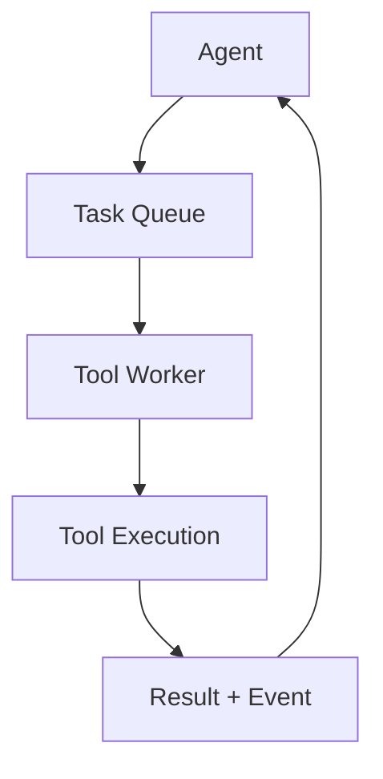

# Phase 3 — Tool Runtime & Worker Architecture

- **Status:** Planning
- **Goal:** Separate tool execution from the agent process.
- **Prev:** [phase2.md](phase2.md) · **Next:** [phase4.md](phase4.md)

## 1. Objective

Move from inline execution:

```text
Agent
 │
 ├── filesystem
 ├── shell
 └── web
```

to a runtime:

```text
Agent
   │
   ▼
Tool Runtime
   │
   ▼
Task Queue
   │
   ▼
Tool Worker
```

A tool becomes executable independently of the agent process.

## 2. Tool Registry

Replace branching:

```text
if tool == "bash": ...
elif tool == "search": ...
```

with:

```text
ToolRegistry
    │
    ├── filesystem.read
    ├── filesystem.write
    ├── shell.execute
    ├── web.search
    └── git.diff
```

A tool contains:

- `name`
- `description`
- input schema
- handler

### Capability vs Tool

Separate:

```text
Capability
    ↓
Provider
    ↓
Tool
```

Example:

```text
Bash Capability
      │
      ▼
Bash Provider
      │
      ▼
shell.execute
```

This allows the execution mechanism to change later:

```text
Local Bash
    ↓
Docker
    ↓
E2B
    ↓
Remote execution
```

without changing the model-facing tool.

Stable interfaces (see [overview.md](overview.md)): `Tool`, `ToolProvider`.

## 3. Worker Architecture

Start with Redis + Worker.

Flow:



```text
Agent
 ↓
Queue
 ↓
Worker
 ↓
Tool
 ↓
Result
 ↓
Event
 ↓
Agent
```

The worker system introduces:

- asynchronous execution
- retries
- timeouts
- task states (queued, running, succeeded, failed, timed out, cancelled)
- backpressure
- worker failures

Implementation notes:

- Agent enqueues a `tool_call` event; worker claims it.
- Results return as `tool_result` events so Phase 2 replay still works.
- Timeouts and retries live in the runtime, not in the agent loop.
- Registry validation happens before enqueue to fail fast on bad args.
- Idempotency keys prevent double execution on retry.

## 4. Completion Criteria

- [ ] a tool can be executed without running the agent loop in the same process
- [ ] enqueue → worker → tool → result → event → agent works end to end
- [ ] timeouts terminate runaway tools
- [ ] retries handle transient worker failures
- [ ] duplicate deliveries do not duplicate side effects

## 5. Exit Criteria / Unlocks

- Agent process never blocks on arbitrary shell / I/O.
- Phase 4 can swap the worker’s execution backend for a sandbox without changing the agent.
