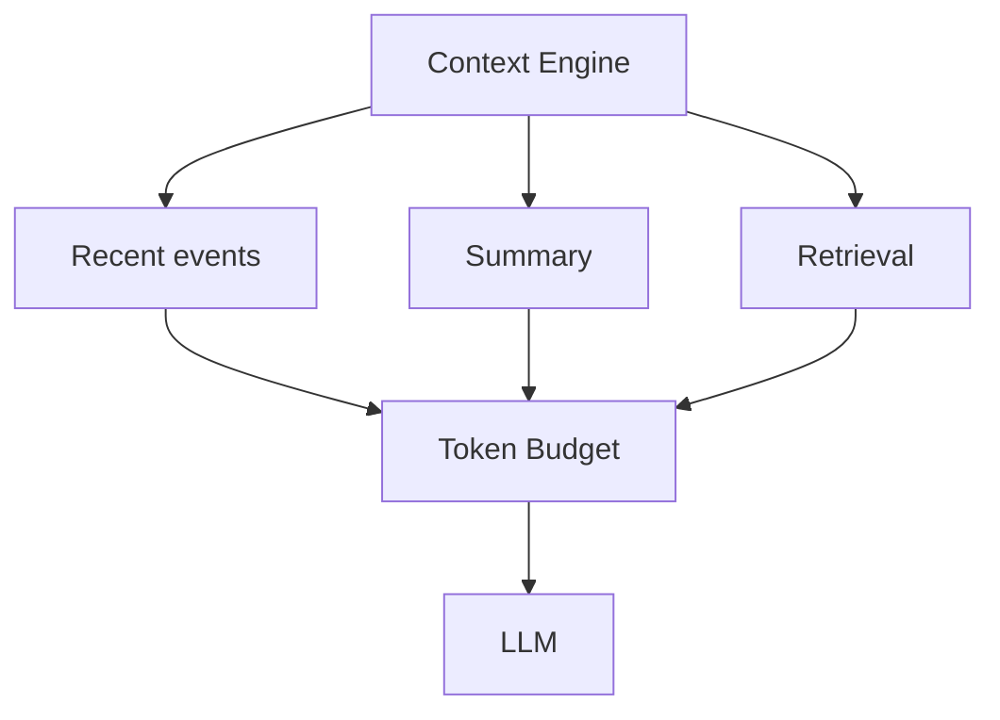

# Phase 5 — Context Engine

- **Status:** Planning
- **Goal:** Solve the context scalability problem.
- **Prev:** [phase4.md](phase4.md) · **Next:** [phase6.md](phase6.md)

## 1. Objective

A session may eventually contain 100,000 events, but the LLM cannot consume all of them.

Therefore:



```text
                 Context Engine
                      │
        ┌─────────────┼─────────────┐
        ▼             ▼             ▼
   Recent events   Summary       Retrieval
        │             │             │
        └─────────────┼─────────────┘
                      ▼
                 Token Budget
                      │
                      ▼
                     LLM
```

## 2. Components

The Context Engine can eventually contain:

- sliding window
- summarizer
- retriever
- token budgeter
- priority system
- tool-result selection
- relevant history

Early code surface:

```text
core/context/builder.py
core/context/summarizer.py
core/context/tokenizer.py
```

## 3. Key Responsibility

Answer one question per step:

> What information should the model see right now?

This is different from simply storing everything (Phase 2 stores everything; Phase 5 selects).

Selection inputs:

- recency and sequence order
- summaries of older spans
- retrieved events / artifacts by relevance
- token budget and priority (system > user task > tool results > history)
- truncation / redaction of oversized tool outputs

## 4. Completion Criteria

- [ ] given a large session, the system constructs a bounded context
- [ ] context contains the information most relevant to the current agent step
- [ ] token budget is enforced before the model call
- [ ] recent events are preserved verbatim while older history is summarized or retrieved on demand

## 5. Exit Criteria / Unlocks

- Long sessions no longer degrade or break the Phase 1 loop.
- Phase 6 subagents can receive scoped context instead of full parent history.
