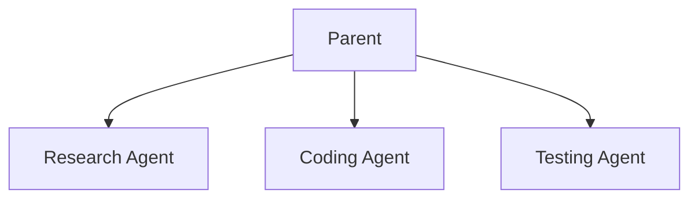

# Phase 6 — Subagents

- **Status:** Planning
- **Goal:** Allow an agent to delegate work.
- **Prev:** [phase5.md](phase5.md) · **Next:** [phase7.md](phase7.md)

## 1. Objective

Support fan-out:



```text
                    Parent
                      │
             ┌────────┼────────┐
             ▼        ▼        ▼
          Research   Coding   Testing
           Agent      Agent     Agent
```

A subagent is not a completely different runtime. Conceptually:

```text
Subagent = Agent + New Session + Restricted Capabilities
```

## 2. Example

```text
Parent Agent
    │
    ├── Research Agent
    │       └── understand repository
    │
    ├── Coding Agent
    │       └── implement change
    │
    └── Testing Agent
            └── run tests
```

Each child has its own session. The parent eventually receives a child result and incorporates it into its context (via the Phase 5 Context Engine).

## 3. Responsibilities

The orchestration layer must handle:

- spawning
- scheduling
- communication
- context (scoped handoff, not full parent dump)
- results
- failures
- cancellation

Early code surface:

```text
core/orchestration/scheduler.py
core/orchestration/subagents.py
```

Design notes:

- Child sessions link to the parent (`parent_session_id`, task assignment event).
- Capabilities are restricted per child (e.g. research child gets read-only tools).
- Parent loop blocks or polls on child completion; child events stay in the child session.
- Failures and cancellation propagate as events so Phase 2 replay remains consistent.

## 4. Core Flow

```text
Create child agent
       ↓
Assign task
       ↓
Child executes
       ↓
Child completes
       ↓
Parent receives result
       ↓
Parent continues
```

## 5. Completion Criteria

An agent can:

- [ ] create a child agent
- [ ] assign a task with scoped context and capabilities
- [ ] run the child to completion, failure, or cancellation
- [ ] receive the child result
- [ ] continue the parent loop with that result

## 6. Exit Criteria / Unlocks

- Parallel delegation works without corrupting parent state.
- Phase 7 can expose orchestration itself as a plugin.
