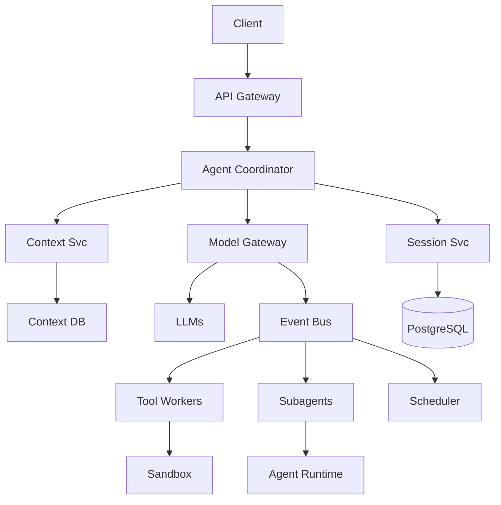

# Phase 8 — Production Distributed Architecture

- **Status:** Planning
- **Goal:** Take the system from an educational distributed runtime to a production-oriented architecture.
- **Prev:** [phase7.md](phase7.md) · **Next:** [overview.md](overview.md)

## 1. Objective

Evolve toward the destination topology from [overview.md](overview.md):



```text
                         CLIENT
                           │
                           ▼
                    ┌─────────────┐
                    │ API Gateway │
                    └──────┬──────┘
                           │
                           ▼
                  ┌──────────────────┐
                  │ Agent Coordinator │
                  └────────┬─────────┘
                           │
             ┌─────────────┼─────────────┐
             ▼             ▼             ▼
        Context Svc    Model Gateway   Session Svc
             │             │             │
             ▼             ▼             ▼
        Context DB        LLMs       PostgreSQL
                           │
                           ▼
                      Event Bus
                           │
          ┌────────────────┼────────────────┐
          ▼                ▼                ▼
     Tool Workers      Subagents       Scheduler
          │                │
          ▼                ▼
      Sandbox          Agent Runtime
```

## 2. Infrastructure Evolution

```text
Redis
   ↓
Kafka when necessary
```

```text
Docker
   ↓
Kubernetes / Firecracker
```

```text
Single API
   ↓
Multiple services
```

```text
PostgreSQL
   ↓
PostgreSQL + replicas
```

```text
Docker Compose
   ↓
Kubernetes
```

Deployment path: `apps/api` + `apps/worker` split first, then independent Context / Model Gateway / Session services.

## 3. Distributed-System Problems

These are first-class goals, not secondary concerns — a major reason for building from scratch:

- worker failure
- exactly-once vs at-least-once execution
- idempotency
- distributed locks
- concurrent tool calls
- cancellation
- token budgets
- sandbox isolation
- repository locking
- distributed tracing
- event ordering
- backpressure
- horizontal scaling
- millions of sessions
- GPU scheduling

Each maps to earlier primitives:

- idempotency and ordering build on Phase 2 `(session_id, sequence_number)` uniqueness
- timeouts, retries, and backpressure build on Phase 3 workers
- isolation builds on Phase 4 sandboxes
- budgets build on Phase 5 context
- fan-out builds on Phase 6 orchestration
- backend swaps build on Phase 7 plugins

Observability and ops: OpenTelemetry traces across Coordinator → Event Bus → Worker → Sandbox, Prometheus metrics, structured events per session.

## 4. Completion Criteria

- [ ] API, Coordinator, Context Svc, Model Gateway, Session Svc can scale independently
- [ ] event bus supports the required throughput (Redis Streams → Kafka path proven)
- [ ] worker failures, retries, and cancellation are correct under concurrency
- [ ] sandbox isolation and repository locking hold under parallel sessions
- [ ] tracing, metrics, and event ordering work across services

## 5. Relation to Overall Definition of Done

Satisfying this phase means the full flow in [overview.md](overview.md) holds in production: task → session → replaceable-model reasoning → permission-checked tools → async sandboxed execution → persisted events → failure recovery → relevant context → subagent delegation → final response, with independently replaceable components.
